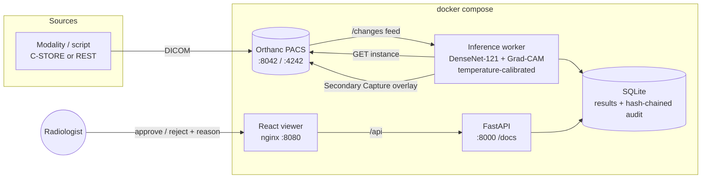
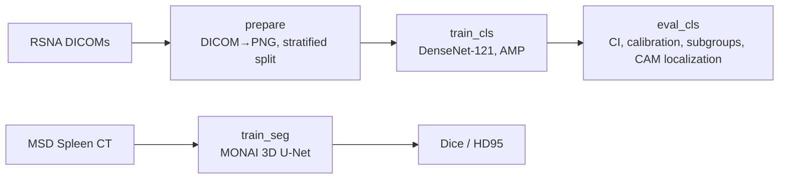

# AI-Assisted Medical Imaging & Diagnosis System

> ⚠️ **For education and research only. Not a medical device. Not for clinical use.**
> Every AI output in this system is a suggestion that a qualified radiologist must review.

An end-to-end platform for AI-assisted radiology: chest X-rays (DICOM) arrive at an **Orthanc PACS**, a
worker runs a **DenseNet-121** classifier with **Grad-CAM** explanations, and a **React reading-room viewer**
lets a radiologist approve or reject each finding. Every decision goes into a **hash-chained, append-only audit log**.
A separate **MONAI 3D U-Net** segments the spleen in abdominal CT.

| | |
|---|---|
| Classification | RSNA Pneumonia Detection (26,684 chest X-rays, native DICOM, radiologist boxes) |
| Segmentation | Medical Segmentation Decathlon Task09 Spleen (CT) |
| Stack | PyTorch · MONAI · Grad-CAM · Orthanc · FastAPI · React/TypeScript · DVC · Docker · W&B |

## Results

All numbers are produced by `dvc repro` and read from `reports/` (never typed by hand).

| Metric (held-out test set) | Value |
|---|---|
| AUROC (95% bootstrap CI), 4,003 test images, 22.5 % positive | **0.882 (0.870 – 0.894)** · AUPRC 0.699 |
| Sensitivity / Specificity @ val-selected threshold | **0.839 / 0.759** (PPV 0.50, NPV 0.94) |
| ECE before → after temperature scaling | 0.073 → 0.071 (T = 1.29; the model was already close to calibrated) |
| Grad-CAM pointing game (hit inside radiologist box) | 54 % of positive test images (mean IoU 0.24) |
| Shortcut check: AUROC from view / view+sex+age alone (no pixels) | 0.707 / 0.725, so the image adds about +0.16 AUROC over metadata |
| Spleen Dice / HD95 (mm), 8 validation CTs, largest-component post-processing | **0.939 / 3.2** (raw 0.930 / 22.6; worst case 0.925). 600 epochs on a Kaggle T4, best epoch 224. The same code for 200 epochs on the laptop GTX 1650 reaches 0.912 / 6.1 (`reports/seg_laptop_200ep/`). MSD has no public test labels, so this is validation |

Subgroup performance (sex, age band, AP vs PA view) is in `reports/subgroups.csv` and discussed in the
[model card](docs/MODEL_CARD.md).

## What makes this more than a demo

- **Explanations are measured, not just shown.** RSNA includes radiologist bounding boxes, so Grad-CAM is scored with the
  *pointing game* and *IoU*. A heatmap that looks plausible is not evidence that it is correct.
- **Statistically honest evaluation.** Bootstrap 95% CIs, calibration (ECE + reliability diagram), and the operating
  threshold and temperature are fit on validation only, so the test set is touched exactly once.
- **Bias audit.** Performance is broken down by sex, age band and view position. AP (portable) films are sicker patients,
  which gives the model a known shortcut. We measure it and warn about it in the UI.
- **Real DICOM flow.** Studies enter through Orthanc (REST or DICOM C-STORE). The AI result is written back into the
  same study as a DICOM Secondary Capture, so it also appears in any PACS viewer.
- **Tamper-evident audit trail.** Each entry stores `sha256(prev_hash + entry)`. SQLite triggers block UPDATE/DELETE, and
  `/api/audit/verify` pinpoints the first altered row. Rejecting an AI finding requires a written reason.
- **No train/serve skew.** Training and the live service share the same DICOM decoding (`medimg.data.dicom`) and
  preprocessing code.
- **Reproducible.** DVC pipeline `prepare → train_cls → eval_cls` and `train_seg`, all driven by `params.yaml`.

## Architecture



Training pipeline (DVC):



## Quick start

### 1. Train (free Kaggle GPU)
Import `notebooks/kaggle_train.ipynb` into Kaggle, attach the *rsna-pneumonia-detection-challenge* dataset, and Run All.
Download `aiml02_outputs.tgz` and extract it into the repo root (it contains `models/` and `reports/`).

Local training also works (`dvc repro`) but needs `classifier.batch_size: 6` on a 4 GB GPU.

### 2. Run the system
```bash
docker compose up --build
python scripts/upload_to_orthanc.py data/raw/rsna/stage_2_train_images --from-test-split 40
```
Open **http://localhost:8080**. Studies appear in the worklist within a few seconds.

| Service | URL |
|---|---|
| Radiologist viewer | http://localhost:8080 |
| API + OpenAPI docs | http://localhost:8000/docs |
| Orthanc (demo login `orthanc`/`orthanc`) | http://localhost:8042 |

Viewer shortcuts: `J`/`K` next/previous study · `O` toggle overlay · `A` approve · `R` write a rejection reason ·
drag to pan · shift+drag window/level · wheel zoom.

### 3. Develop
```bash
uv venv .venv --python 3.12
uv pip install --python .venv torch torchvision --index-url https://download.pytorch.org/whl/cu124
uv pip install --python .venv -r requirements.txt -r services/inference/requirements.txt -e .
.venv/Scripts/python -m pytest          # CPU-only, no dataset needed
cd web && npm install && npm run dev    # http://localhost:5173, proxies /api to :8000
```

## API

Full schema: [`docs/openapi.json`](docs/openapi.json) (OpenAPI 3, regenerated by `scripts/export_openapi.py` and
checked by a test), or the interactive version at http://localhost:8000/docs when the stack is running.

| Method | Path | Purpose |
|---|---|---|
| GET | `/api/health` | model version, worker status, disclaimer |
| GET | `/api/results?status=` | worklist (`pending_review` / `approved` / `rejected`) |
| GET | `/api/results/{id}` | one AI result |
| GET | `/api/results/{id}/image.png`, `/cam.png` | display image and transparent Grad-CAM layer |
| POST | `/api/results/{id}/review` | `{decision, reviewer, reason}`. A reason is required for reject |
| GET | `/api/audit?instance_id=` | audit entries (newest first) |
| GET | `/api/audit/verify` | recompute the hash chain |
| GET | `/api/stats` | pending count, radiologist agreement, mean latency |

## Repository layout
```
src/medimg/            training library (data, models, Grad-CAM, evaluation, 3D segmentation)
services/inference/    FastAPI + Orthanc worker + audit store (Dockerfile)
services/orthanc/      PACS configuration
web/                   React + TypeScript viewer (Dockerfile, nginx)
notebooks/             Kaggle training notebook
scripts/               demo data loader
tests/                 pytest: DICOM handling, Grad-CAM, statistics, audit chain, API
docs/                  model card, architecture notes
params.yaml, dvc.yaml  reproducible pipeline
```

## Limitations
See [docs/MODEL_CARD.md](docs/MODEL_CARD.md). In short: single-source training data, binary label only, no
prospective validation, Grad-CAM is coarse (about 12×12 at the last layer), and performance differs across view positions.
**Not for clinical use.**
